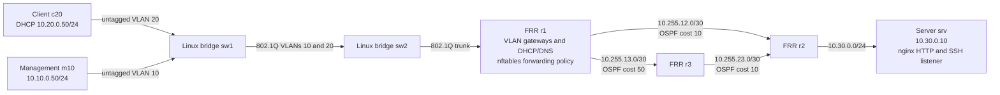

# Segmented network commissioning and fault isolation

## Scenario and relevance

A fictional operations team commissions management/client VLANs and a routed server segment, then investigates controlled connectivity faults. This connects NCC networking/security study to junior connectivity checks, configuration records, access-policy verification and escalation. Implementation and candidate contribution are separate: see the evidence index and personal-practice guide.

## Actual architecture



Each drawn link is a separate internal Docker network. Docker's initial addresses are removed from lab interfaces; the topology uses the recorded addresses. VLAN-aware Linux bridges actually switch tagged frames. The topology is acyclic at layer 2; STP is disabled. No Cisco RSTP result follows from this implementation. OSPF is a routed triangle, not a layer-2 loop.

| Link | Addresses |
|---|---|
| VLAN 10 | r1 10.10.0.1/24, m10 10.10.0.50/24 |
| VLAN 20 | r1 10.20.0.1/24, c20 DHCP reservation 10.20.0.50/24 |
| r1-r2 | r1 10.255.12.1/30, r2 10.255.12.2/30 |
| r1-r3 | r1 10.255.13.1/30, r3 10.255.13.2/30 |
| r2-r3 | r2 10.255.23.1/30, r3 10.255.23.2/30 |
| Server segment | r2 10.30.0.1/24, srv 10.30.0.10/24 |

DHCP supplies an address, router and DNS server. `app.lab` is a deliberately local DNS fixture. The HTTP body is checked exactly. Management-origin traffic can reach the actual SSH TCP listener; client-origin SSH is explicitly rejected. Both segments may use HTTP and lab ICMP diagnostics. Other forwarding is dropped. The SSH test checks a real protocol banner/connection, not authenticated login or key administration.

## Run and inspect

From the project root:

```sh
python3 scripts/labctl.py build
python3 scripts/labctl.py lab1 --actor assistant
```

For your own practice use the [candidate guide](../../docs/CANDIDATE_PRACTICE.md), `--actor candidate` and `--keep`. Read the shared Docker capability/isolation disclosure first. FRR uses separate daemon configuration files and explicit daemon starts; systemd/watchfrr operations are not tested.

Source: [runner](../../scripts/lab1.py), [firewall](../../configs/lab1/firewall.nft). Actual run evidence includes `topology.json`, the DHCP lease/options, route/neighbor/interface output, nftables counters, generated configuration read back from routers and packet captures. The source manifest and image ID identify what was executed. Review [results](../../evidence/INDEX.md); a run is successful only when its checks, final status and cleanup are successful.

## Tests and operational reasoning

Commission first with static routes, then remove them and verify OSPF adjacencies, learned routes and useful end-to-end HTTP. A Full adjacency alone does not establish application availability. Accelerated one-second hello/four-second dead intervals make a small lab observable; they are not default production tuning advice.

| Deliberate fault | Discriminating observations | Corrective action and validation |
|---|---|---|
| VLAN 20 missing on sw2 trunk | Client gateway fails, management gateway remains reachable, VLAN table differs | Restore VLAN 20; repeat HTTP and segment tests |
| Client gateway changed to .254 | Correct local gateway remains reachable, remote direct-IP HTTP fails, default route is wrong | Restore .1; verify client request and route |
| DNS record changed to 10.30.0.99 | Wrong DNS answer, direct-IP service remains healthy, named request fails | Restore correct record; verify DNS and named HTTP |
| Spare link has area 1 instead of area 0 | Spare neighbor disappears, interface-area evidence differs, preferred path still works | Correct area; verify adjacency and service |
| Primary r1-r2 interface shut | Selected route changes to r3 and service recovers | Restore link; verify preferred route and forwarding |

Before changing a real network, identify the asset/interface, scope and rollback. This runner injects only the listed isolated faults. Failover observations include controller/poll latency and are one lab measurement, not a production SLA or generic convergence guarantee. OSPF packets and VLAN tags are captured from actual software interfaces; no capture is generated from an expected-output template.

## Limits and references

No physical cabling, transceiver handling, commercial appliance, production network, Cisco IOS execution or authenticated SSH administration is established. Packet Tracer practice remains separately pending in [its exercise](../../docs/PACKET_TRACER_EXERCISE.md). Platform versions and results must remain distinct.

References: [Linux Ethernet bridge](https://docs.kernel.org/networking/bridge.html), [FRR 8.4 setup](https://docs.frrouting.org/en/stable-8.4/setup.html), [FRR OSPF](https://docs.frrouting.org/en/stable-8.4/ospfd.html), [Cisco VLAN trunk concepts](https://www.cisco.com/c/en/us/td/docs/switches/lan/c9000/lyr2-fwd/vlan/vlan-configuration-guide/configure-vlan-trunks.html). Independently implemented with AI assistance; no external lab project copied.
