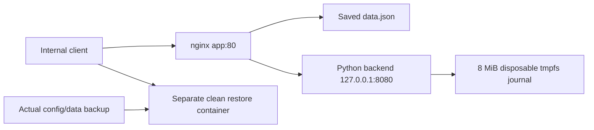

# Linux service maintenance and recovery

## Scenario

Maintain a fictional small application behind nginx, protect a known configuration baseline, investigate a startup failure and permission error, and demonstrate recovery to a clean target. This develops systems/log investigation, controlled changes, backup verification and useful service-restoration evidence.



The frontend serves `/data.json`, proxies `/health`, and proxies POST `/events` to a real backend. Events append to a deliberately bounded 8 MiB tmpfs. Space exhaustion is confined to that disposable filesystem; the runner never fills the laptop disk.

## Run

```sh
python3 scripts/labctl.py lab2 --actor candidate
```

The shared image must be built first. [Runner](../../scripts/lab2.py), [startup supervisor](../../runtime/service_supervisor.py), [backend](../../runtime/service_backend.py) and [nginx configuration](../../runtime/nginx-service.conf) are readable source. Candidate practice uses the separate [guide](../../docs/CANDIDATE_PRACTICE.md).

## Verification and troubleshooting

The runner checks an actual served document and backend health, updates document version to 2, and restarts the container to verify data/configuration persistence. It saves the real nginx configuration and data document in a tar archive, with hashes, file modes and explicit exclusions.

An unknown nginx directive is then added. Syntax validation must reject it while the already-running worker can still serve the old valid configuration. A controlled container restart demonstrates the resulting actual outage. The known-good configuration is read from the genuine backup and copied into the stopped container; restart and client checks establish restoration. Do not assume a rejected reload necessarily caused an outage.

Changing the data document to mode 000 should produce a real 403 and a permission-denied log entry. Restore mode 644 and verify the client response. This distinguishes an access problem from routing or DNS failure.

A bounded file consumes the journal filesystem. A POST must fail with HTTP 507 and ENOSPC (errno 28), while read/health responses remain available. Inspect block and inode usage, remove only the injected fill file, and verify successful writes. A green read-only health endpoint alone is insufficient evidence that a service's write path works.

Finally, intentionally damaged data is observed through a real client response. A separate clean container receives the backup; restored bytes, modes, version and useful HTTP/write behavior are checked. The original source is also returned to its good state. Restore duration is the measured creation/restore/validation observation, not a promised production RTO.

## Evidence and limits

See [evidence index](../../evidence/INDEX.md) for actual runs. Evidence includes syntax/startup logs, HTTP responses, permission diagnostics, filesystem indicators, a genuine backup/manifest, restore hashes and final validation. Failed runs remain available.

This is a Linux container service exercise. No systemd boot, VM boot, RAID rebuild, server component replacement, HA architecture, encrypted backup design or physical server work is demonstrated. The ephemeral pressure journal is excluded from the config/data backup and is not restored. The operating system/image is a separate dependency. A production design would need explicit data inventory, retention, permissions, secure storage, recovery requirements and independent restore testing.

Operations discipline: state the rollback trigger, validate config before restart, collect evidence before repair, verify the client path, and record what remains degraded. Actual candidate diagnosis/communication remains separately assessed.

References: [nginx command-line/configuration control](https://nginx.org/en/docs/switches.html), [nginx beginner guide](https://nginx.org/en/docs/beginners_guide.html). This is a software recovery exercise; source provenance and dependency attribution are preserved.
