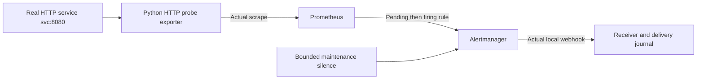

# Monitoring, incident response and operational handover

## Scenario and implementation

Monitor a real internal HTTP service, distinguish an application outage from a failed monitoring path, validate alert delivery/resolution, and conduct controlled maintenance with a silence. Connect those observations to a junior incident report and shift handover.



The probe exporter requests the actual service and checks its response. It emits `lab_probe_success` and observed request duration. Prometheus's `up` measures the exporter scrape path. Node Exporter, host temperatures, physical power metrics and SNMP monitoring are not implemented or claimed in this project.

## Run and read

```sh
python3 scripts/labctl.py lab3 --actor candidate
```

Dependencies are in the shared image. See [runner](../../scripts/lab3.py), [Prometheus config](../../configs/lab3/prometheus.yml), [rules](../../configs/lab3/rules.yml), [Alertmanager route](../../configs/lab3/alertmanager.yml), [real probe](../../runtime/probe_exporter.py) and [receiver](../../runtime/alert_receiver.py).

No notifications go to real people or external services. Containers share only a newly created internal network; no host ports are published. The webhook receiver is an actual local HTTP destination, not an email/Slack/SMS integration.

## Tests

Promtool tests synthetic time-series fixtures for pending/firing duration, recovery and missing application metrics. They are explicitly rule-unit cases. Independent runtime checks then exercise the entire actual delivery path.

1. Verify successful exporter scrapes and successful application probes.
2. Stop the application container; observe a real pending service alert while the exporter still scrapes successfully, then actual firing webhook delivery.
3. Restart the service; verify recovery and an actual resolved webhook delivery.
4. Stop only the probe exporter; independently request the service, inspect failed scrape status, and observe the exporter alert. Do not interpret `up == 0` as proof the application is down.
5. Restore the exporter and verify resolved delivery.
6. Create a bounded Alertmanager silence, stop the service for maintenance, and verify that Prometheus still evaluates/fires the rule while Alertmanager marks it silenced and withholds the new firing notification.
7. Restore service, verify healthy metrics, close the silence, and check final active alerts.

One-second scrape/evaluation, five-second alert holds and short grouping windows are accelerated lab settings. Delivery timing includes polling/command latency and is not a production detection SLA. Missing probe metrics create an observability gap, not affirmative evidence of health.

## Operations records and physical-awareness tabletop

Use the [operations guide](../../docs/OPERATIONS.md) for incident, change and handover expectations. Actual run observations and delivery journals are available through the [evidence index](../../evidence/INDEX.md).

The [fictional rack/work-order fixture](../../configs/lab3/tabletop.json) is checked for overlapping/out-of-range rack units and a mismatched cross-connect endpoint. The requested asset is SW01; the observed label fixture identifies SW02. The correct junior action is to stop and clarify/escalate before patching. This is an executed record-consistency check against fictional input, not physical work.

Two labelled PDU feeds do not establish independent upstream power or measured redundancy. UPS/PDU/cooling incidents require authorized site procedures and appropriate facilities escalation; no switching or electrical maintenance occurs here.

References: [Prometheus alerting rules](https://prometheus.io/docs/prometheus/latest/configuration/alerting_rules/), [rule tests](https://prometheus.io/docs/prometheus/latest/configuration/unit_testing_rules/), [Alertmanager configuration](https://prometheus.io/docs/alerting/latest/configuration/). My personal handover and diagnosis practice is separate from automated reference verification.
